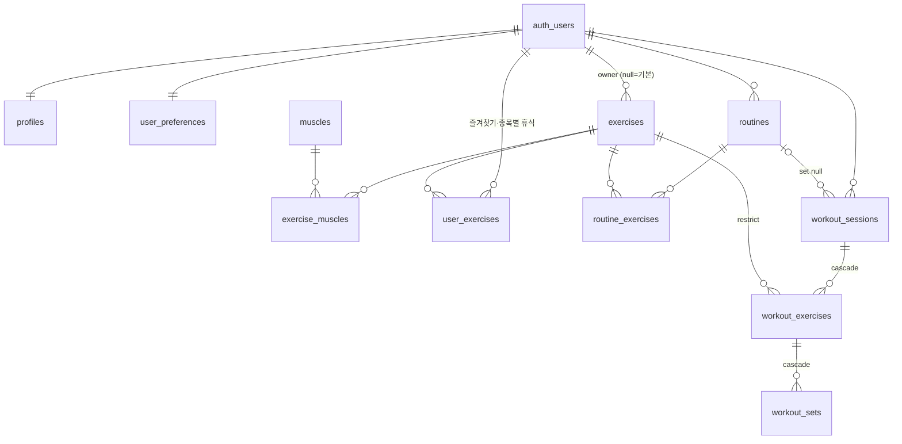

# MyFit AI — 설계 문서

개인용(단일 사용자) AI 헬스 트레이너 웹앱. 이 문서는 전체 설계와 단계별 구현 상태를 기록한다.
✅ 구현됨 · 🔜 다음 단계 · ⏳ 이후 단계

---

## 1. 기능 명세

| 영역 | 기능 | Phase | 상태 |
|---|---|---|---|
| 인증 | 이메일/비밀번호 로그인, 가입 화면 없음(Supabase에서 가입 비활성화), 세션 갱신 proxy | 1 | ✅ |
| 홈 | 오늘 날짜·예정 루틴·운동 시작, 이번 주 횟수/목표 달성률/운동량/시간, 연속 운동 주, 근육별 주간 세트, 최근 운동, 빈 상태 안내 | 1 | ✅ |
| 홈 | 최근 PR, 주요 종목 중량 추이, 목표 진행률, 카드 순서 변경 | 2 | ✅ |
| 홈 | AI 추천·코칭 요약 / 체중 변화 | 3 / 4 | ⏳ |
| 운동 기록 | 빈 운동·루틴·지난 운동 복사로 시작, 시작 시각 자동 기록, 경과 시간, 일시정지/재개 | 1 | ✅ |
| 운동 기록 | 세트 유형(W/본/D/F), 중량·횟수·시간·거리, RPE·RIR, 완료 여부/시각, 세트 간 휴식 시간, 세트·종목 메모 | 1 | ✅ |
| 운동 기록 | 직전 기록 표시·완료 시 자동 채움, 세트 추가/복사/삭제/이동, 종목 추가/삭제/교체/이동, 슈퍼세트 | 1 | ✅ |
| 운동 기록 | 자동저장(멱등·순서 보장), 기기 임시 보관 후 복구, 저장 실패 표시·재시도, 되돌리기, 종료 전 요약, 삭제 확인 | 1 | ✅ |
| 운동 기록 | 휴식 타이머(종료 시각 기준, 백그라운드 안전), 진동·소리·알림, 종목별/기본 휴식 시간, 화면 꺼짐 방지 | 1 | ✅ |
| 운동 기록 | AI 추천 운동으로 시작 | 3 | ⏳ |
| 히스토리 | 월별 목록, 상세(세트·운동량), 수정(같은 편집기), 삭제, 다시 하기 | 1 | ✅ |
| 루틴 | 직접 제작·수정·삭제·복사, 종목 순서, 세트 수·반복 범위·목표 중량·휴식, 슈퍼세트, 요일 배치, 예상 시간, 사용 횟수·최근 수행 | 1 | ✅ |
| 루틴 | 기본 템플릿 10종(초보자, 전신, 2·3·4·5분할, PPL, 상/하체, 근비대, 근력) | 1 | ✅ |
| 루틴 | 4~16주 장기 프로그램(요일 패턴, 디로드 주기, 진행률) | 2 | ✅ |
| 라이브러리 | 기본 64종, 부위·기구·난이도·유형·즐겨찾기 필터, 상세(자세·주의·대체 운동), 종목별 휴식 시간, 직접 추가/삭제(기록에 쓰였으면 보관) | 1 | ✅ |
| 계획·캘린더 | 주간 루틴 배치, 월/주/일 캘린더(완료·예정·미수행·휴식), 일정 추가·이동·건너뛰기, 매주 반복 | 2 | ✅ |
| 통계 | 기간별(일/주/월/년) 운동량·빈도·시간·세트·반복, 근육별 세트, 종목별 중량 추이·최고 기록·추정 1RM, PR 경신 내역, 목표 달성률·루틴 수행률, 두 기간 비교 | 2 | ✅ |
| 근육 분석 | 근육도(앞/뒤), 근육별 주간 세트·지난주 대비·4주 빈도·최근 훈련일·주간 목표 세트, 회복 참고(추정) | 2 | ✅ |
| 목표·성취 | 주간 횟수/시간, 종목 중량·반복, 연속 주, 체중(신체 기록 연결 시), 배지(과훈련 유도 없음) | 2 | ✅ |
| 설정 | 이름, 주간 목표, 기본 휴식, 중량 증가 단위, 다크/라이트 | 1 | ✅ |
| 설정 | CSV 내보내기 | 2 | ✅ |
| 설정 | JSON 백업·복원·삭제 | 5 | ⏳ |
| AI 트레이너 | 기록 기반 대화, 계획 생성·승인 적용, 교체 추천, 리포트 | 3 | ⏳ |
| 점진적 과부하 | 규칙 기반 중량·횟수 추천, 정체 감지, 디로드 | 3·5 | ⏳ |
| 신체·영양·수면 | 측정·사진(비공개 저장소), 식단·영양, 수면·컨디션 | 4 | ⏳ |
| PWA·오프라인·웨어러블 | 설치형 앱, 선택적 오프라인, 외부 데이터 가져오기 | 5 | ⏳ |

### 계산 규칙
- **운동량(kg)**: 완료한 본세트(워밍업 제외)의 `중량 × 횟수` 합. `맨몸+추가중량`은 추가중량만 반영. 맨몸·보조·시간·거리 유형은 운동량 0이며 횟수·시간·거리로 따로 집계 (`src/lib/workout/stats.ts`).
- **근육별 세트**: 완료 본세트 기준, 주동근 1세트·보조근 0.5세트.
- **주 단위**: 사용자 시간대(기본 Asia/Seoul) 월요일 시작.
- **통계는 항상 원본 세트에서 재계산**한다. 별도 집계 테이블이 없으므로 수정·삭제가 즉시 반영된다.

---

## 2. 화면 구조

```
/login                     로그인 (공개)
/(app)  ── 사이드바(PC) / 하단 탭(모바일: 홈·히스토리·[운동]·루틴·라이브러리)
  /                        홈 대시보드
  /workout                 진행 중 운동 편집기 | 시작 옵션
  /history                 운동 기록 목록
  /history/[id]            상세
  /history/[id]/edit       완료 기록 수정(같은 편집기)
  /routines                내 루틴 + 기본 템플릿
  /routines/new, /[id]     루틴 편집기
  /exercises               운동 라이브러리(필터, 상세 시트, 직접 추가)
  /settings                설정
  /plan /calendar /coach /stats /muscles /body /nutrition /wellness /goals
                           → "준비 중(Phase N)" 안내 페이지 (src/app/(app)/[section])
```

PC 오른쪽 AI 인사이트 패널은 AI 기능(Phase 3)과 함께 추가한다.

---

## 3. 폴더 구조

```
supabase/migrations/        SQL 마이그레이션(스키마·RLS·RPC·시드)
src/proxy.ts                세션 갱신 + 비로그인 리다이렉트
src/app/login/              로그인 페이지·액션
src/app/(app)/              인증 영역 페이지
src/app/actions/            Server Actions (workout, routines, exercises, settings)
src/components/ui/          shadcn/ui
src/components/shell/       사이드바·하단 탭·테마
src/components/workout/     운동 편집기, 세트 행, 종목 선택, 휴식 타이머, 자동저장 훅
src/components/routines/    루틴 편집기·메뉴
src/components/exercises/   라이브러리·종목 추가
src/lib/auth.ts             requireUser (JWT 검증 + RLS 클라이언트)
src/lib/data.ts             서버 전용 조회 함수
src/lib/workout/            편집 상태 모델/리듀서, Zod 스키마, 통계 계산(순수 함수)
tests/unit/                 순수 로직 단위 테스트
tests/db/                   PGlite로 마이그레이션·RPC·RLS 검증
tests/e2e/                  Playwright 핵심 흐름(실제 Supabase 필요)
```

---

## 4. 데이터베이스

### ERD (Phase 1 구현분)



전체 SQL: [`supabase/migrations/20261031000001_phase1_core.sql`](../supabase/migrations/20261031000001_phase1_core.sql), 시드: [`..._seed_exercises.sql`](../supabase/migrations/20261031000002_seed_exercises.sql)

### 설계 원칙
- **템플릿과 기록 분리**: `routines/routine_exercises`(계획)와 `workout_sessions/exercises/sets`(실제 수행)는 별개. 기록은 종목명을 스냅샷(`exercise_name`)으로 보존하고, 기록에 쓰인 종목은 삭제 대신 `archived_at`으로 보관(`on delete restrict`).
- **소유권 일관성**: 모든 개인 테이블에 `user_id` + RLS(`user_id = auth.uid()`). 자식 테이블은 `(parent_id, user_id)` 복합 FK로 다른 사용자의 부모에 붙을 수 없다.
- **삭제**: 운동 삭제는 하드 삭제 + cascade → 통계에 남지 않는다.
- **진행 중 운동은 사용자당 1개**: 부분 유니크 인덱스.
- **멱등 자동저장**: 클라이언트 UUID + `save_workout(p_session, p_revision)` RPC가 한 트랜잭션에서 upsert/삭제. `client_revision`보다 낮은 요청은 무시(늦게 도착한 요청이 최신 값을 덮지 않음).
- **권한**: anon은 모든 테이블 접근 불가, authenticated만 RLS를 거쳐 접근. RPC는 `security invoker`.

### Phase 2 추가 (`20261101000001_phase2_planning.sql`)
- `user_goals`: kind(weekly_count/weekly_minutes/exercise_weight/exercise_reps/body_weight/streak_weeks), target_value, exercise_id(운동 목표일 때 필수, CHECK), deadline
- `training_programs`: 시작일, 주 수, 디로드 주기, 요일 패턴(jsonb) / `program_schedules`: 날짜별 일정, status(planned/skipped), is_deload
- `user_preferences.dashboard_order`, `muscle_set_targets`
- `create_program` RPC(프로그램+일정 원자적 생성)
- **설계 변경**: `personal_records`, `goal_progress`, `achievements`, `program_weeks` 테이블은 만들지 않았다. PR·목표 진행률·배지는 원본 세트에서 매번 계산해 수정·삭제가 즉시 반영되고, 주차 정보는 프로그램 시작일과 패턴에서 계산된다.

### 이후 단계 테이블(미생성, 단계별 마이그레이션으로 추가)

| Phase | 테이블 | 핵심 컬럼 / 비고 |
|---|---|---|
| 2 | `equipment_profiles` | 사용 가능한 기구 목록(AI 계획 반영) |
| 3 | `ai_conversations`, `ai_messages` | 대화 / role, content, tool_calls(jsonb: 조회한 데이터 범위 기록) |
| 3 | `ai_recommendations`, `ai_plan_versions` | 제안 payload(jsonb), status(pending/approved/rejected), before/after, applied_at |
| 3 | `ai_insights`, `workout_feedback` | 주간 리포트, 세션 피로도·통증 입력 |
| 4 | `body_measurements`, `body_photos` | 측정값·메모 / Storage 비공개 버킷 경로(RLS) |
| 4 | `food_items`, `meals`, `meal_items`, `nutrition_goals` | source(user/db/estimated) 구분 |
| 4 | `daily_wellness_logs` | 수면, 피로도, 컨디션, 안정시 심박, 걸음 수, source(manual/import) |
| 5 | `data_import_jobs` | 백업 복원·외부 연동 작업 상태 |

---

## 5. API 설계 (Server Actions)

모든 액션은 `requireUser()`로 JWT를 검증하고 Zod로 입력을 검증한 뒤 RLS 클라이언트로 DB에 접근한다.

| 액션 | 입력 | 동작 |
|---|---|---|
| `saveWorkout(payload, revision)` | 세션 전체 스냅샷 | `save_workout` RPC (자동저장) |
| `startWorkout(form)` | mode: empty / routine / copy | 세션 생성 후 `/workout` 이동. 진행 중 세션이 있으면 그것으로 이동 |
| `deleteWorkout(id)` | uuid | 세션 삭제(cascade) |
| `fetchPreviousSets(ids, exclude)` | 종목 uuid[] | `previous_sets` RPC |
| `saveRoutine(input)` | 루틴 + 항목 | `save_routine` RPC (원자적 전체 교체) |
| `deleteRoutine / duplicateRoutine / createFromTemplate` | | |
| `createExercise / removeCustomExercise / updateExerciseSettings` | | 사용자 종목, 즐겨찾기·휴식 |
| `updateSettings / signOut / login` | | |

조회는 Server Component에서 `src/lib/data.ts` 함수를 직접 호출한다.

---

## 6. AI 처리 구조 (Phase 3 설계)

```
질문/요청 → [의도 분류] → [도구 선택: 서버의 고정 조회 함수만 허용]
         → DB 조회 (기간·종목·지표가 명시된 집계 쿼리, RLS 적용)
         → 요약 생성(숫자는 서버에서 계산, LLM은 계산하지 않음)
         → 안전 규칙·선호도 주입 → LLM 호출(서버, 환경변수 키)
         → 구조화 JSON 응답 Zod 검증 (실패 시 재시도/오류)
         → 화면 표시 (근거 데이터·조회 범위 함께 표시)
         → 계획 변경은 ai_recommendations(pending) 저장 → 전후 비교 → 사용자 승인 시에만 서버 API로 적용 → ai_plan_versions 기록
```

- **근거 없는 답변 방지**: 응답 스키마에 `evidence`(조회한 쿼리 ID와 결과 요약) 필수. 조회 결과가 비면 "데이터 부족" 응답 템플릿을 강제.
- **중량 추천은 규칙 기반**: 목표 반복 범위 상단을 모든 본세트에서 달성하고 평균 RPE ≤ 8(또는 RIR ≥ 2)이면 종목별 증가 단위만큼 증량, 하단 미달이 2회 연속이면 유지/감량, 3회 이상 정체면 정체 표시·디로드 제안. LLM은 설명만 생성.
- **안전**: 진단·치료 금지, 통증 입력 시 운동 중단·전문가 상담 안내, 과도한 볼륨 증가(주간 세트 +20% 초과) 제안 차단.
- **비용**: 요청당 토큰 상한, 일일 요청 수 제한, 응답 캐시(같은 기간 리포트).

---

## 7. Phase 1 구현 계획 (완료)

1. Next.js 16 + Tailwind 4 + shadcn/ui 스캐폴딩, 다크 기본 테마 ✅
2. Supabase SSR 클라이언트, proxy 세션 갱신, 로그인 ✅
3. 마이그레이션: 코어 스키마·RLS·RPC, 기본 종목 시드 ✅
4. 앱 셸(사이드바·하단 탭), 홈 대시보드 ✅
5. 운동 라이브러리, 루틴 CRUD·템플릿 ✅
6. 운동 편집기·자동저장·휴식 타이머·히스토리 ✅
7. 단위·DB·E2E 테스트 ✅ (E2E는 실제 Supabase 연결 후 실행)

**완료 조건**: 실제 운동 세션을 저장하고 새로고침 후 다시 불러오기 → DB 레벨(PGlite)에서 검증 완료, 브라우저 E2E는 Supabase 연결 후 `npm run test:e2e`.

---

## 8. 테스트 및 실행

README의 "설치" 절 참고. 테스트 요구사항 매핑:

| # | 요구사항 | 검증 |
|---|---|---|
| 1 | 새로고침 후 유지 | e2e `workout.spec.ts`, db `applies edits… reload` |
| 2 | 이전 기록 표시 | db `previous_sets…` |
| 3 | 세트 추가/삭제 | unit reducer, e2e |
| 4 | 중복 저장 없음 | db `idempotent`, `ignores stale` |
| 5 | 수정 시 통계 갱신 | unit `recomputes…`, e2e 수정 후 운동량 |
| 6 | 삭제 시 통계 반영 | db `cascades`, e2e 삭제 |
| 7 | 모바일 입력 | e2e(Pixel 7) 포커스 유지 검증, 수동 확인 필요 |
| 8 | 백그라운드 타이머 | unit `restRemaining` (종료 시각 기준) |
| 9–11 | AI | Phase 3 |
| 12 | 다른 계정 접근 불가 | db `RLS` |
| 13 | API 키 미노출 | e2e 번들 검사, 비밀 키는 서버 전용 환경변수 |
| 14 | 백업·복원 | Phase 5 |
| 15 | 빈 기록·네트워크 오류 | 빈 상태 UI, `error.tsx`, 자동저장 실패 배지·재시도 |
